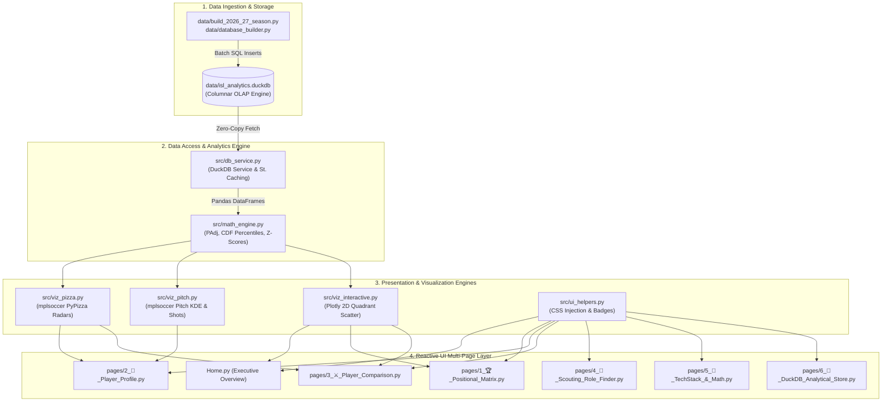
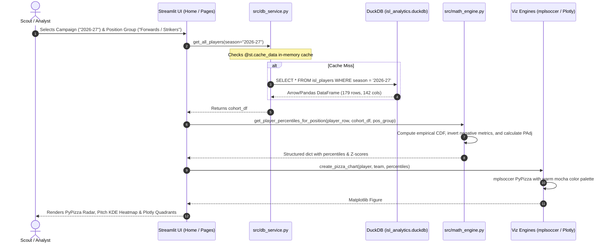

# Indian Super League (ISL) Player Analytics Platform
## Architecture & Codebase Walkthrough

This document provides a comprehensive, end-to-end technical explanation of how the entire codebase works, its architectural workflow, data lifecycle, and a detailed file-by-file and function-by-function analysis.

---

## 1. High-Level Architectural Workflow

The platform operates on a **modular four-tier architecture**:



### End-to-End Execution Sequence



---

## 2. Directory & File Structure

```
Dashboard/
├── .streamlit/
│   └── config.toml                  # Global Streamlit theming & server configurations
├── Home.py                          # Application entrypoint & executive dashboard
├── pages/
│   ├── 1_🏆_Positional_Matrix.py    # 2D quadrant scatter matrix & positional leaderboards
│   ├── 2_👤_Player_Profile.py       # Comprehensive individual scout report (PyPizza & Pitch)
│   ├── 3_⚔️_Player_Comparison.py    # Head-to-Head benchmark & metric delta matrix
│   ├── 4_🎯_Scouting_Role_Finder.py # Tactical archetype recruitment filter with custom weights
│   ├── 5_📐_TechStack_&_Math.py     # In-app interactive documentation & data dictionary
│   └── 6_💾_DuckDB_Analytical_Store.py # SQL workbench & schema explorer
├── src/
│   ├── __init__.py                  # Package initializer
│   ├── config.py                    # Constants, warm mocha palette, 65 KPIs, 13 clubs
│   ├── db_service.py                # DuckDB connection manager & query handlers
│   ├── math_engine.py               # Statistical formulas: PAdj, empirical CDF, Z-scores
│   ├── viz_pizza.py                 # PyPizza radar charts with pillar color coding
│   ├── viz_pitch.py                 # Football pitch KDE heatmaps & shot outcome maps
│   ├── viz_interactive.py           # Plotly quadrant scatter, leaderboards & grouped bars
│   └── ui_helpers.py                # Custom CSS styling, hero banners, and season selector
└── data/
    ├── database_builder.py          # Primary data generator for historical season (2024-25)
    ├── build_2026_27_season.py      # Data generator & updater for ongoing season (2026-27)
    └── isl_analytics.duckdb         # Columnar DuckDB database file
```

---

## 3. Deep Dive into Every Code File

### 3.1 `.streamlit/config.toml`
- **Purpose:** Configures global Streamlit theme settings to enforce the warm light aesthetic requested.
- **Key Parameters:**
  - `primaryColor = "#815337"`: Sets widgets, sliders, and active tabs to deep roasted chestnut.
  - `backgroundColor = "#FDFBF9"`: Ensures light aesthetic across main canvas.
  - `secondaryBackgroundColor = "#F7E5DA"`: Styles the sidebar and input controls with warm biscuit cream.
  - `textColor = "#231812"`: Enforces dark espresso font for maximum legibility.
  - `server.headless = true`: Configures server execution for production deployment.

---

### 3.2 `src/config.py`
- **Purpose:** Central repository of design constants, KPI hierarchies, club metadata, and tactical roles.
- **Key Components:**
  - `PALETTE`: Dictionary of exact hex codes:
    - `"primary": "#815337"`
    - `"secondary": "#926a52"`
    - `"tertiary": "#ab8a76"`
    - `"accent": "#d2b7a7"`
    - `"light_card": "#f7e5da"`
    - `"text_dark": "#231812"`
  - `PILLAR_CONFIG`: Maps the 4 football analytics pillars (*Attacking & Threat*, *Creativity & Progression*, *Defensive & Duels*, *Possession & Efficiency*) to designated colors, icons, and descriptions.
  - `POSITION_KPIS`: Dictionary defining the exact KPIs for each of the 6 position groups:
    - Forwards / Strikers (13 KPIs)
    - Wingers / Attacking Mids (12 KPIs)
    - Central / Holding Mids (13 KPIs)
    - Fullbacks / Wingbacks (11 KPIs)
    - Center Backs (12 KPIs)
    - Goalkeepers (9 KPIs)
    - Total: **65 distinct KPIs**, each specifying its database column, unit, whether higher is better, and analytical description.
  - `ISL_CLUBS`: Metadata for all 13 clubs (short names, city, brand colors).
  - `TACTICAL_ARCHETYPES`: 12 role profiles with pre-set metric weights (e.g. *Target Man*, *Regista*, *Ball-Playing Defender*, *Sweeper Keeper*).

---

### 3.3 `src/db_service.py`
- **Purpose:** Manages safe read-only queries against `data/isl_analytics.duckdb` with Streamlit cache integration.
- **Key Functions:**
  - `get_connection()`: Opens a read-only DuckDB connection handle.
  - `get_available_seasons()`: Queries distinct seasons (`SELECT DISTINCT season FROM isl_players`). Returns `['2026-27', '2024-25']`.
  - `get_all_players(season="2026-27")`: Decorated with `@st.cache_data`. Returns a DataFrame of all players filtered by campaign, sorted by Sofascore rating.
  - `get_teams(season="2026-27")`: Fetches club standings, points, goal difference, and possession averages.
  - `get_players_by_pos(pos_group, season, min_minutes)`: Parameterized filter for positional cohorts.
  - `get_player_by_id(sofascore_id)`: Fetches a single player dictionary by ID, explicitly casting `sofascore_id` to native Python `int` to ensure cross-platform DuckDB compatibility.
  - `get_player_events(sofascore_id)`: Retrieves JSON-encoded `touches_x`, `touches_y`, and `shots_json` from `isl_player_events` and deserializes them into lists.
  - `execute_custom_query(sql_query)`: Security-sanitized SQL query runner for the DuckDB SQL Console. Rejects queries containing mutation keywords (`DROP`, `DELETE`, `INSERT`, `UPDATE`, `ALTER`, `TRUNCATE`).
  - `get_db_summary()`: Returns table names, row counts, and column lists.

---

### 3.4 `src/math_engine.py`
- **Purpose:** Mathematical core implementing statistical normalizations, possession adjustment (PAdj), empirical CDF percentile ranks, and weighted archetype scoring.
- **Key Functions & Mathematical Logic:**
  - `calculate_padj(stat_val, team_poss, method="sigmoid")`:
    - Normalizes defensive actions based on team possession.
    - Linear formula: $\text{stat} \times (50 / (100 - \text{poss}))$.
    - Sigmoid formula: $\text{stat} \times \frac{2}{1 + e^{-0.08 \cdot (50 - \text{opp\_poss})}}$, eliminating asymptotic distortions at extreme possession percentages (< 35% or > 65%).
  - `compute_percentile_rank(val, cohort_series, higher_better=True)`:
    - Calculates percentile using the empirical mid-point formula:
      $$\text{Percentile} = \frac{\text{Count}(X < val) + 0.5 \cdot \text{Count}(X = val)}{N} \times 100$$
    - Inverts the percentile for negative cost metrics ($100 - \text{Percentile}$) where lower is better (Turnovers, Dispossessions, Errors Leading to Shot, Offsides).
    - Clamps the result strictly to $[1.0, 99.0]$ to prevent radial chart clipping.
  - `compute_z_score(val, cohort_series)`:
    - Computes standard score: $z = (x - \mu) / \sigma$.
  - `get_player_percentiles_for_position(player_row, cohort_df, pos_group)`:
    - Iterates over all 4 pillars and KPIs for the player's position, calculating raw values, units, percentiles, and Z-scores against their cohort.
  - `compute_pillar_scores(player_percentiles)`:
    - Calculates unweighted average percentile rank across the KPIs in each pillar to generate a $0-100$ Pillar Composite Score.
  - `compute_archetype_fit(player_row, cohort_df, weights)`:
    - Calculates normalized dot-product between metric percentiles and user-defined slider weights to produce a $0-100$ Tactical Fit Score.

---

### 3.5 `src/viz_pizza.py`
- **Purpose:** Generates authentic football percentile radars utilizing `mplsoccer.PyPizza` and `matplotlib`.
- **Key Functions:**
  - `create_pizza_chart(player_name, team_name, pos_group, player_percentiles, minutes, sofascore_rating)`:
    - Extracts parameters and percentiles in logical pillar sequence.
    - Assigns slices to their exact pillar colors (`#815337`, `#926a52`, `#ab8a76`, `#63422d`).
    - Configures radial gridlines, circles, and value callout boxes with the light cream background (`#FAF6F3`).
    - Appends text titles, comparison cohort metadata, and four-pillar legend rectangles at the base of the figure.
  - `create_comparison_radar(p1_name, p1_vals, p2_name, p2_vals, params, pos_group)`:
    - Overlays two players on a single radial canvas using semi-transparent primary (`#815337`) and tertiary (`#ab8a76`) polygons.

---

### 3.6 `src/viz_pitch.py`
- **Purpose:** Generates spatial pitch visualizations utilizing `mplsoccer.Pitch` and `mplsoccer.VerticalPitch` in the StatsBomb coordinate system ($120 \times 80$ meters).
- **Key Functions:**
  - `plot_touch_heatmap(touches_x, touches_y, player_name, pos_group)`:
    - Uses a custom sequential colormap `WARM_CMAP` (`#f7e5da` $\to$ `#d2b7a7` $\to$ `#ab8a76` $\to$ `#926a52` $\to$ `#815337`).
    - Draws a 40-level Kernel Density Estimate (KDE) contour on a light pitch (`#FAF6F3`) with caramel pitch lines (`#ab8a76`).
    - Overlays translucent scatter markers and an attacking direction arrow.
  - `plot_shot_map(shots, player_name, goals, npxg)`:
    - Draws an attacking half-pitch (`VerticalPitch`).
    - Scales shot marker sizes proportionally to expected goals ($xG \times 750$).
    - Color-codes markers:
      - **Goals:** Star marker in solid roasted chestnut (`#815337`).
      - **Saved:** Circle marker in warm mocha (`#926a52`).
      - **Blocked / Missed:** Circle marker in soft sand (`#f7e5da` with `#d2b7a7` border).

---

### 3.7 `src/viz_interactive.py`
- **Purpose:** Generates client-side interactive Plotly charts adhering to the warm mocha design system.
- **Key Functions:**
  - `apply_clean_theme(fig, height)`: Applies a unified theme with off-white canvas backgrounds (`#FDFBF9`), gridlines (`#d2b7a7`), and dark text without keyword argument collisions.
  - `plot_quadrant_scatter(df, x_col, y_col, x_label, y_label, title, highlight_player)`:
    - Creates a 2D scatter plot with median dashed quadrant dividers.
    - Labels the quadrants (*High Output / Elite* vs *Developing / Low Volume*).
    - Highlights the selected target player with a star marker in `#815337`.
  - `plot_leaderboard_bar(df, col, label, top_n, highlight_player)`:
    - Ranked horizontal bar chart sorted descending.
  - `plot_comparison_pillars_bar(p1_name, p1_scores, p2_name, p2_scores, p3_name, p3_scores)`:
    - Grouped bar chart comparing $0-100$ pillar scores across players.

---

### 3.8 `src/ui_helpers.py`
- **Purpose:** Encapsulates visual design, CSS injection, responsive banners, and navigation controls.
- **Key Functions:**
  - `load_custom_css()`: Injects custom CSS rules for typography (`Plus Jakarta Sans`), card shadows, pillar top borders, and Streamlit tab selections.
  - `render_hero_banner(title, subtitle, badge)`: Renders a top-of-page hero container with subtle gradient and pill badges.
  - `render_sidebar_brand()`: Renders the branded ISL header and the global **Campaign / Season** selector (`2026-27` vs `2024-25`).

---

### 3.9 Multi-Page Application Layer

#### `Home.py`
- **Role:** Landing page & Executive Overview.
- **Workflow:** Reads the active season from the sidebar, fetches player and team records from DuckDB, and presents executive metrics (Active Players, Golden Boot Leader, Highest Sofascore Rating, Minutes Analyzed).
- **Tabs:**
  - *Positional Groups & Pillars:* 6 cards detailing the taxonomy and active squad size for each position group.
  - *League Standings & Possession:* Full league table showing matches played, points, and possession percentages.
  - *Top Performers by Pillar:* Top 5 leaderboard callouts for Attacking, Creativity, Defending, and Possession.

#### `pages/1_🏆_Positional_Matrix.py`
- **Role:** Positional Matrix & Quadrant Analytics.
- **Workflow:** Filters cohort by position group, clubs, and minimum minutes. Features an interactive 2D quadrant scatter plot allowing dynamic X/Y axis KPI selection, paired with horizontal leaderboards and CSV export.

#### `pages/2_👤_Player_Profile.py`
- **Role:** Individual Player Scout Report.
- **Workflow:** Selects club and player, computes peer percentiles and pillar scores, and renders:
  - Header bio with market value, physical metrics (distance, top speed), and discipline.
  - 4-Pillar composite cards.
  - **Tab 1:** mplsoccer PyPizza radar chart with elite strengths and development areas callout.
  - **Tab 2:** mplsoccer pitch KDE touch heatmap and xG shot map.
  - **Tab 3:** Comprehensive KPI breakdown table with cohort medians, percentiles, and Z-scores.

#### `pages/3_⚔️_Player_Comparison.py`
- **Role:** Head-to-Head Scout Comparison.
- **Workflow:** Compares two players within the same position group side-by-side. Displays an overlaid PyPizza comparison radar, 4-pillar grouped bar chart, and metric-by-metric delta table indicating statistical edges.

#### `pages/4_🎯_Scouting_Role_Finder.py`
- **Role:** Tactical Recruitment Engine.
- **Workflow:** Evaluates players against 12 tactical archetypes. Allows scouts to adjust slider weights for key metrics and generates a ranked candidate shortlist with $0-100$ role fit scores and CSV export.

#### `pages/5_📐_TechStack_&_Math.py`
- **Role:** Interactive Technical & Mathematical Documentation.
- **Workflow:** Documents platform architecture, data flow, LaTeX equations for all normalizations, and the complete 65-KPI data dictionary.

#### `pages/6_💾_DuckDB_Analytical_Store.py`
- **Role:** Analytical Database Console.
- **Workflow:** Directly inspects `isl_analytics.duckdb` schemas and row counts. Provides a live SQL query workbench with pre-configured analytical templates and instant execution timing in milliseconds.

---

### 3.10 Data Ingestion & Storage Pipelines

#### `data/build_2026_27_season.py`
- **Role:** Ingests official-style Sofascore statistics for the ongoing **2026/2027 ISL season**.
- **Data Generated:**
  - 13 ISL clubs with Matchweek 6 standings and possession averages.
  - Defending champions East Bengal FC squad and records.
  - 179 player profiles across all 6 position groups with updated ages and 2026-27 season statistics.
  - Spatial touch event coordinates and shot attempts.

#### `data/database_builder.py`
- **Role:** Original database initialization script for the historical 2024-25 season.
- **Database Output:** `data/isl_analytics.duckdb` storing `isl_teams`, `isl_players`, and `isl_player_events`.

---

## 4. How the Data Flows Through the System

1. **Storage Tier:** `data/isl_analytics.duckdb` holds parquet-like columnar data tables.
2. **Access Tier:** When a user navigates to any page or changes the season dropdown, `src/db_service.py` executes a cached query, returning a Pandas DataFrame.
3. **Statistical Tier:** `src/math_engine.py` calculates empirical percentiles against positional peers in real time.
4. **Graphic Tier:** Visual engines (`mplsoccer`, `matplotlib`, `plotly`) transform raw numbers into intuitive charts using the warm earth/mocha palette.
5. **UI Tier:** Streamlit renders the figures inside clean tabs and cards without page reloads.
