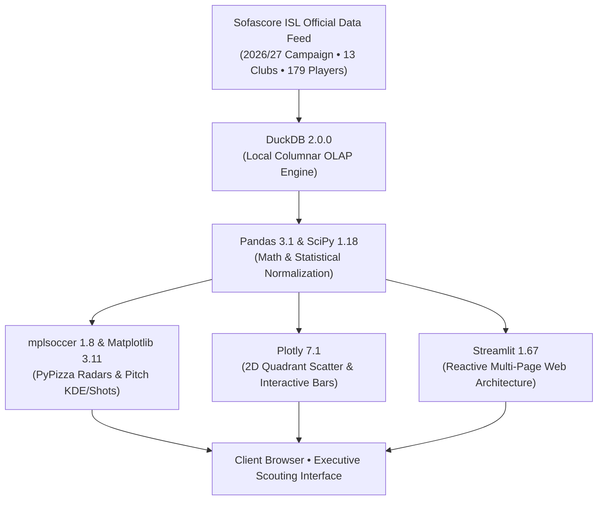

# ⚽ Indian Super League (ISL) Player Analytics Platform
### Dynamic Positional Scouting, Tactical Evaluation & Local Analytical OLAP Suite

An enterprise-grade football intelligence platform designed for **Indian Super League (ISL)** technical directors, recruitment analysts, and tactical coaches. Powered by **DuckDB**, **mplsoccer**, **Matplotlib**, **Plotly**, **Pandas**, and **SciPy**, utilizing official Sofascore data for the **2026/2027 ISL campaign**.

---

## 🎨 Visual Identity & Palette

The platform strictly implements a warm earth/mocha palette paired with high-contrast dark espresso typography and light surfaces:

| Hex Code | Semantic Role | Application in Dashboard |
| :--- | :--- | :--- |
| `[#815337]` | Deep Roasted Chestnut | Primary brand accent, top percentile rank, **Pillar 1: Attacking & Threat** |
| `[#926a52]` | Warm Mocha / Walnut | Secondary accent, **Pillar 2: Creativity & Progression** |
| `[#ab8a76]` | Muted Caramel / Latte | Tertiary accent, **Pillar 3: Defensive & Duels**, pitch line markings |
| `[#d2b7a7]` | Soft Sand / Tan | Card borders, quadrant dividing gridlines, subtle separators |
| `[#f7e5da]` | Warm Biscuit Cream | Light surface fills, pill badges, card backgrounds |
| `[#63422d]` | Dark Walnut / Espresso | **Pillar 4: Possession & Efficiency** |
| `[#FDFBF9]` | Off-White & Cream | Main viewport background, light canvas aesthetics |
| `[#231812]` | Deep Espresso | Dark font color for high contrast and readability |

---

## 🛠️ Technology Stack



- **Reactive Web Application:** `Streamlit 1.67.0` (Multi-page state management with `@st.cache_data`)
- **Football Pitch & Radar Plots:** `mplsoccer 1.8.1` & `matplotlib 3.11.2` (`PyPizza` percentiles, `Pitch` bivariate KDE touch heatmaps and shot maps in StatsBomb $120 \times 80\text{m}$ coordinates)
- **Interactive Visualizations:** `plotly 7.1.0` (Client-side interactive 2D quadrant scatter plots with cohort medians)
- **Data Manipulation & Mathematics:** `pandas 3.1.1`, `numpy 2.5.4`, and `scipy 1.18.1` (Vectorized empirical CDF percentiles, Z-scores, Sigmoidal PAdj)
- **Local Analytical Storage:** `duckdb 2.0.0` (Columnar analytical database engine providing sub-millisecond query execution)
- **Data Feed:** Sofascore ISL Data Feed (Season 2026/2027, Matchweeks 1–6, 13 clubs, 179 players)

---

## 📂 Repository File Breakdown

```
Dashboard/
├── .streamlit/
│   └── config.toml                  # Streamlit theme tokens (#815337, light surfaces, dark text)
├── Home.py                          # Main entrypoint: Executive League Dashboard & Standings
├── pages/
│   ├── 1_🏆_Positional_Matrix.py    # 2D quadrant scatter matrix & positional leaderboards
│   ├── 2_👤_Player_Profile.py       # Deep scout report: PyPizza, Touch KDE & Shot Maps
│   ├── 3_⚔️_Player_Comparison.py    # Head-to-Head benchmark & metric delta matrix
│   ├── 4_🎯_Scouting_Role_Finder.py # Tactical archetype recruitment filter with custom weights
│   ├── 5_📐_TechStack_&_Math.py     # In-app interactive documentation & data dictionary
│   └── 6_💾_DuckDB_Analytical_Store.py # SQL workbench & schema explorer
├── src/
│   ├── __init__.py                  # Python package initializer
│   ├── config.py                    # Constants, warm mocha palette, 65 KPIs, 13 clubs
│   ├── db_service.py                # DuckDB read-only connection with @st.cache_data
│   ├── math_engine.py               # Statistical formulas: PAdj, empirical CDF, Z-scores
│   ├── viz_pizza.py                 # PyPizza radar charts with pillar color coding
│   ├── viz_pitch.py                 # Football pitch KDE heatmaps & shot outcome maps
│   ├── viz_interactive.py           # Plotly quadrant scatter, leaderboards & grouped bars
│   └── ui_helpers.py                # Custom CSS styling, hero banners, and brand badges
├── data/
│   ├── build_2026_27_season.py      # Data ingestion & builder for 2026-27 season
│   ├── database_builder.py          # Foundational database builder and schema initializer
│   └── isl_analytics.duckdb         # Columnar DuckDB database file (179 players, 13 clubs)
├── requirements.txt                 # Python package dependencies
├── .gitignore                       # Git exclusion rules (.venv, __pycache__, etc.)
├── ARCHITECTURE.md                  # Comprehensive technical architectural documentation
└── README.md                        # Project documentation (this file)
```

### Detailed File Roles:

| File Path | Functional Description |
| :--- | :--- |
| **`.streamlit/config.toml`** | Binds theme colors (`primaryColor = "#815337"`, `backgroundColor = "#FDFBF9"`, `textColor = "#231812"`), and configures headless execution. |
| **`Home.py`** | Executive landing page with key headline metrics, club standings, possession benchmarks, and top performer spotlights. |
| **`pages/1_🏆_Positional_Matrix.py`** | Interactive quadrant scatter plots allowing scouts to compare any two positional metrics against cohort medians with player highlighting. |
| **`pages/2_👤_Player_Profile.py`** | Complete scout dossier: player bio, 4-pillar cards, `mplsoccer` PyPizza radar, pitch KDE touch heatmap, shot map, and percentile breakdown. |
| **`pages/3_⚔️_Player_Comparison.py`** | Side-by-side player comparison featuring an overlaid PyPizza radar, 4-pillar grouped bar chart, and delta matrix with statistical edges. |
| **`pages/4_🎯_Scouting_Role_Finder.py`** | Recruitment engine matching players against 12 tactical archetypes using customizable metric slider weights with CSV shortlist export. |
| **`pages/5_📐_TechStack_&_Math.py`** | In-app documentation page presenting platform architecture, LaTeX mathematical formulations, and the complete 65-KPI data dictionary. |
| **`pages/6_💾_DuckDB_Analytical_Store.py`** | Embedded SQL query console for direct queries on `isl_players` and `isl_teams` with sub-millisecond execution times. |
| **`src/config.py`** | Defines design tokens, the 4 analytical pillars, 65 positional KPIs, club metadata, and default tactical archetype weights. |
| **`src/db_service.py`** | Manages DuckDB connection pooling, `@st.cache_data` caching, parameterized positional queries, and sanitized SQL execution. |
| **`src/math_engine.py`** | Implements Sigmoidal & Linear PAdj, empirical CDF percentiles with inversion for negative metrics, Z-scores, and weighted archetype fit. |
| **`src/viz_pizza.py`** | Generates PyPizza percentile radar charts color-coded by the 4 pillars with light backgrounds and dark typography. |
| **`src/viz_pitch.py`** | Generates authentic spatial touch density KDE heatmaps and xG-scaled shot maps using `mplsoccer.Pitch` and `VerticalPitch`. |
| **`src/viz_interactive.py`** | Plotly 2D quadrant scatter plots, horizontal ranked leaderboards, and grouped pillar comparison bar charts. |
| **`src/ui_helpers.py`** | Injects custom CSS styling, metric cards, pill badges, and active campaign header banners. |
| **`data/build_2026_27_season.py`** | Generates and ingests 2026/27 ISL campaign records, standings, squad profiles, touch events, and shot maps into DuckDB. |
| **`data/isl_analytics.duckdb`** | Local columnar database storage housing `isl_teams`, `isl_players`, and `isl_player_events`. |

---

## 🎯 4-Pillar Positional KPI Taxonomy

The platform assesses players across **6 Position Groups** and **4 Analytical Pillars** (65 total KPIs):

### 1. Forwards / Strikers
- **⚡ Attacking & Threat:** Goals/90, Non-Penalty xG (npxG)/90, Post-Shot xG (PSxG), Shots on Target %
- **🪄 Creativity & Progression:** xG Assisted (xGA)/90, Shot-Creating Actions (SCA)/90, Touches in Box/90
- **🛡️ Defensive & Duels:** Final-Third Tackles, High-Intensity Pressures/90, Aerial Win %
- **🎯 Possession & Efficiency:** Goal Conversion %, npxG per Shot (Shot Quality), Offsides/90 *(inverted)*

### 2. Wingers / Attacking Mids
- **⚡ Attacking & Threat:** npxG + xGA/90, Goal-Creating Actions (GCA)/90, Box Entries/90
- **🪄 Creativity & Progression:** Key Passes/90, Progressive Carries/90, Successful Take-On %, Cross Completion %
- **🛡️ Defensive & Duels:** Counter-Pressures/90, Recoveries in Attacking Third/90
- **🎯 Possession & Efficiency:** Final Third Pass Completion %, Dispossessed/90 *(inverted)*, Progressive Pass Received/90

### 3. Central / Holding Mids
- **⚡ Attacking & Threat:** Late Box Arrivals/90, Long-Range Shot xG
- **🪄 Creativity & Progression:** Progressive Passes/90, Passes to Final Third/90, Deep Completions, Through Balls/90
- **🛡️ Defensive & Duels:** Possession-Adjusted Tackles + Interceptions (PAdj T+I)/90, Ball Recoveries/90, Duel Win %
- **🎯 Possession & Efficiency:** Pass Completion % under Pressure, Press Resistance %, Turnovers/90 *(inverted)*

### 4. Fullbacks / Wingbacks
- **⚡ Attacking & Threat:** xGA/90, Open-Play Crosses Completed/90, Overlapping Runs into Final Third
- **🪄 Creativity & Progression:** Progressive Carries/90, Progressive Passes/90, Final-Third Entries/90
- **🛡️ Defensive & Duels:** 1v1 Dribble Tackle %, PAdj Interceptions/90, Back-Post Aerial Win %
- **🎯 Possession & Efficiency:** Pass Completion %, Progressive Distance Carried/90

### 5. Center Backs
- **⚡ Attacking & Threat:** Set-Piece xG/90, Set-Piece Aerial Contacts
- **🪄 Creativity & Progression:** Line-Breaking Passes/90, Progressive Pass Distance/90, Switches of Play/90
- **🛡️ Defensive & Duels:** Aerial Duel Win %, Ground Tackle Win %, Shots Blocked/90, Clearances/90, Errors Leading to Shot *(inverted)*
- **🎯 Possession & Efficiency:** Build-up Pass Completion %, Long Pass Accuracy %

### 6. Goalkeepers
- **⚡ Attacking & Threat:** *N/A (Specialist Position)*
- **🪄 Creativity & Progression:** Passes > 40 Yards Completed %, Launch %, Average Goal Kick Length
- **🛡️ Defensive & Duels:** PSxG minus Goals Allowed (PSxG+/-)/90 (Shot-Stopping), Crosses Stopped %, Sweeper Actions Outside Box/90
- **🎯 Possession & Efficiency:** Save %, Pass Completion % under High Press, Clean Sheet %

---

## 📐 Mathematical Formulations

### 1. Per-90 Minute Normalization
$$\text{Metric}_{p90} = \left(\frac{\text{Metric}_{\text{raw}}}{\text{Minutes}}\right) \times 90$$

### 2. Possession-Adjusted Defensive Metrics (PAdj)
Accounting for team possession disparity ($50 / (100 - \text{Possession}_{\text{team}})$):
- **Colin Trainor Linear Formulation:**
  $$\text{PAdj}_{\text{linear}} = \text{Metric}_{\text{raw}} \times \left( \frac{50}{100 - \text{Possession}_{\text{team}}} \right)$$
- **Sigmoidal Logistic Formulation (Anti-Asymptote):**
  $$\text{PAdj}_{\text{sigmoid}} = \text{Metric}_{\text{raw}} \times \frac{2}{1 + e^{-0.08 \cdot (50 - \text{Possession}_{\text{opp}})}}$$

### 3. Empirical CDF Percentile Ranking
$$\text{Percentile}(x) = \left( \frac{\sum_{i=1}^N \mathbb{I}(X_i < x) + 0.5 \sum_{i=1}^N \mathbb{I}(X_i = x)}{N} \right) \times 100$$
*(For inverted metrics where lower counts are superior: $\text{Percentile}_{\text{inv}} = 100 - \text{Percentile}(x)$).*

### 4. Shot-Stopping Post-Shot Expected Goals Delta ($\text{PSxG}+/-$)
$$\text{PSxG}+/-_{p90} = \text{PSxG Faced}_{p90} - \text{Goals Allowed}_{p90}$$

### 5. Tactical Archetype Fit Model
$$\text{Fit Score} = \sum_{m=1}^M w_m \cdot \text{Percentile}(x_m), \quad \sum_{m=1}^M w_m = 1.0$$

---

## 🚀 Quickstart & Installation

### 1. Clone the Repository
```bash
git clone https://github.com/<your-username>/<your-repo-name>.git
cd <your-repo-name>
```

### 2. Set Up Python Virtual Environment
```bash
python3 -m venv .venv
source .venv/bin/activate  # On Windows: .venv\Scripts\activate
```

### 3. Install Dependencies
```bash
pip install -r requirements.txt
```

### 4. Launch the Dashboard
```bash
streamlit run Home.py --server.port=8501
```
Open **`http://localhost:8501`** in your browser.

---

## 📤 Pushing to Your GitHub

To push this project to your GitHub account:

```bash
# 1. Initialize git and stage all files
git init -b main
git add .

# 2. Make initial commit
git commit -m "feat: Initial commit of ISL Player Analytics Platform (2026/27 season)"

# 3. Link your remote GitHub repository
git remote add origin https://github.com/<your-username>/<your-repo-name>.git

# 4. Push to GitHub
git push -u origin main
```
